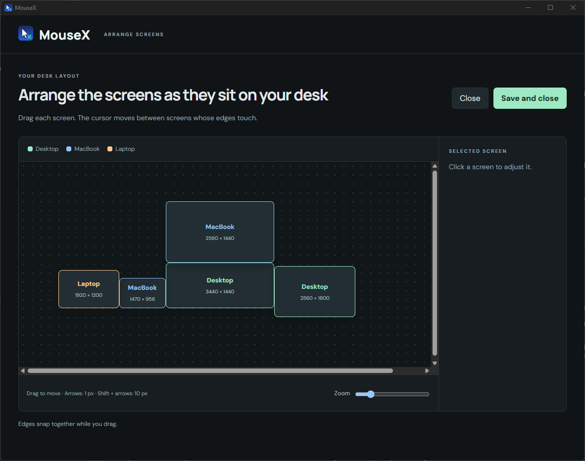
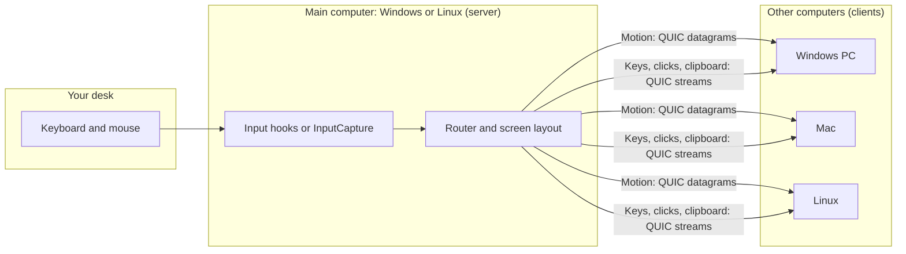

<p align="center">
  
</p>

<h1 align="center">MouseX</h1>

<p align="center">
  <b>One keyboard, one mouse, one clipboard for all your Windows, Mac and Linux computers.</b><br>
  Install once. Never touch it again.
</p>

<p align="center">
  <a href="README.pt-BR.md">🇧🇷 Português</a>
</p>

<p align="center">
  <a href="https://github.com/actus7/mousex/actions/workflows/ci.yml"></a>
  <a href="https://github.com/actus7/mousex/releases/latest"></a>
  
  
</p>

---

## Why MouseX

You have a desk with one keyboard and one mouse, and two or three computers. Switching machines should not mean reaching for another keyboard, typing IP addresses, or editing config files.

MouseX treats your computers as one wide desk. Move the cursor past the edge of one screen and it appears on the next machine. Copy on one computer, paste on another. The setup is a single command per computer, and it keeps working through reboots, sleep, Wi-Fi changes, and monitor changes.

## Highlights

- 🖱️ **Cursor crosses screen edges** between Windows, Mac and Linux, monitor by monitor.
- 🧭 **Arrange screens…** opens a visual editor. Drag screens to match your real desk. On a Linux main computer it opens in the browser (`mousex arrange`).
- 📋 **Clipboard sync** for text, images, and **files and folders**. Copy in Explorer, paste in Finder or in your Linux file manager, and the other way around. Files up to 2 GB.
- 🔐 **Paired and encrypted.** Each device has its own key. Pairing shows the same 6-digit code on both machines, and you confirm it on both.
- 🔎 **No IP addresses.** Computers find each other on the local network.
- 🔁 **Reconnects by itself** after sleep, reboots, and network changes.
- ⌨️ **Keyboard-first controls** to jump between machines (see [Hotkeys](#hotkeys)).
- 🎵 **Media keys** (play/pause, next, previous, volume, mute) work on the Mac and on Linux too.
- 🇧🇷 **ABNT2 and international keyboards** work through scan codes.
- 🪶 **Light.** Written in Rust. Nothing runs in the background except the agent and a tray icon. The editor runs only while it is open.
- 🕵️ **No cloud, no account, no telemetry.**

## Quick start

### Windows

Open PowerShell and run:

```powershell
irm https://github.com/actus7/mousex/releases/latest/download/install.ps1 | iex
```

1. Approve the administrator prompt (UAC).
2. Answer **"Is this the computer whose keyboard and mouse you use?"**. Yes sets this PC as the main computer. No sets it as a controlled computer.
3. Repeat on each other Windows PC. The first pairing shows a 6-digit code. Confirm it on both screens.

Prefer not to use a command? Download `MouseX-windows-x64.zip` from the [Releases page](https://github.com/actus7/mousex/releases/latest), extract it, and double-click `mousex.exe`. You get the same prompts.

### macOS

Open Terminal and run:

```bash
curl -fsSL https://github.com/actus7/mousex/releases/latest/download/install.sh | bash
```

1. Grant **Accessibility** to `mousex-agent` in **System Settings → Privacy & Security → Accessibility**. MouseX needs it to receive and send input.
2. Confirm the pairing code on the Mac and on the main computer.
3. Done. MouseX starts at every login.

### Linux

Open a terminal and run, as your normal user (not with `sudo`):

```bash
curl -fsSL https://github.com/actus7/mousex/releases/latest/download/install.sh | bash
```

1. Confirm the pairing code on Linux and on the main computer.
2. **Wayland only** (the default on Ubuntu, Fedora and KDE): right after the install, the system asks to allow remote control of this desktop. Allow it and choose to remember the choice, so it is not asked again at every login.
3. Done. MouseX starts at every login.

On an **X11** session MouseX works directly. On **Wayland** it uses the desktop's remote control permission (the RemoteDesktop portal with libei), which needs GNOME 46, KDE Plasma 6.1 or newer. Wayland support is **experimental**: please [report](https://github.com/actus7/mousex/issues) how it works on your desktop. If it does not work, log in with the "Xorg" or "X11" session.

### Linux as the main computer

A Linux computer can also be the **main computer**, the one whose keyboard and mouse you use. It needs a **Wayland** session with the InputCapture portal. It was tested on GNOME 46 (Ubuntu 24.04); KDE Plasma 6.1 or newer should work but is not tested yet. An X11 session cannot be the main computer yet.

1. Install with the command above, then switch this computer to the main role:

   ```bash
   ~/.local/share/mousex/bin/mousex install --role server
   ```

2. The desktop asks to allow capturing the keyboard and mouse. Allow it. GNOME 46 asks again every time MouseX starts (login, update).
3. Install the other computers as usual and confirm the pairing code on both screens.
4. A new computer starts on the **right** of your screens. To put it on the left, run `~/.local/share/mousex/bin/mousex side left` (and `side right` to go back). To place the screens freely, open the screen editor with `~/.local/share/mousex/bin/mousex arrange`. Both apply right away.

The default Linux build has no tray icon. Instead, `mousex monitor` opens a status window in the browser: state, pointer, last input, the log, the side of the other computer and a link to **Arrange screens…**. Your Linux screens keep the arrangement from the system settings; in the editor you move the other computers' screens around them.

> **Install the main computer first** (Windows or Linux), then the others. Each new machine asks for pairing once. After that, it is remembered.

### Updating and uninstalling

- **Update:** automatic. Every computer checks for a new release once a day and installs it by itself, but only if it carries a valid MouseX signature. Pairings and your screen layout are kept. To pin a version, set `"auto_update": false` in `config.json` in the data folder; to update right away, run `mousex update`.
- **Uninstall on Windows:** **Settings → Apps → MouseX**, or run `"C:\Program Files\MouseX\mousex.exe" uninstall` in an elevated terminal.
- **Uninstall on macOS:** `~/Library/Application\ Support/mousex/bin/mousex uninstall`
- **Uninstall on Linux:** `~/.local/share/mousex/bin/mousex uninstall`

### Requirements

| | |
|---|---|
| **Windows** | Windows 10 or 11, x64 |
| **macOS** | macOS 12 or newer, Apple Silicon or Intel |
| **Linux** | x86_64 with glibc 2.35 or newer (Ubuntu 22.04, Debian 12, Fedora 36 or newer), systemd, `zenity` or `kdialog` for the pairing prompt. Wayland: GNOME 46 or KDE Plasma 6.1 or newer. As the main computer: Wayland only, with the InputCapture portal |
| **Network** | All computers on the same local network, with no client isolation on Wi-Fi |
| **Firewall** | UDP ports **41414** (connection) and **41415** (discovery) |

## Screenshots

<p align="center">
  
  <br><sub>Arrange screens: drag monitors to match your desk.</sub>
</p>

The tray menu numbers your computers left to right, like the hotkeys:

```text
●  Laptop       Ctrl+Alt+Shift+1
●  MacBook      Ctrl+Alt+Shift+2
●  Desktop      Ctrl+Alt+Shift+3
──────────────────────────────
   Pause sharing
✓  Lock cursor to screen   Scroll Lock
   Reconnect computers
──────────────────────────────
   Arrange screens…
   Open log
```

## Hotkeys

| Keys | Action |
|---|---|
| <kbd>Ctrl</kbd> + <kbd>Alt</kbd> + <kbd>Shift</kbd> + <kbd>1</kbd> … <kbd>9</kbd> | Jump to machine *N*, counting left to right on your desk |
| <kbd>Scroll Lock</kbd> | Lock the cursor to the current machine. It can still move between that machine's monitors |
| <kbd>Ctrl</kbd> + <kbd>Alt</kbd> + <kbd>Shift</kbd> + <kbd>Home</kbd> | Emergency: bring the cursor back home |

The tray menu offers the same actions: **Pause sharing**, **Lock cursor to screen**, **Reconnect**, **Arrange screens…**, and **Open log**.

On a Linux main computer the hotkeys work while you control another computer (so <kbd>Ctrl</kbd> + <kbd>Alt</kbd> + <kbd>Shift</kbd> + <kbd>Home</kbd> always brings the cursor back). While the cursor is home, the desktop does not hand the keys to MouseX: cross a screen edge instead.

## How it works

The computer with the physical keyboard and mouse is the **server**: a Windows PC or, on Wayland, a Linux computer. The other Windows PCs, Macs and Linux computers are **clients**. Macs can only be clients for now.



- **Transport:** QUIC with TLS 1.3. Each device has its own key pair, and each paired device is remembered by its certificate fingerprint.
- **Mouse motion** travels in unreliable datagrams with sequence numbers. Late packets are dropped, so the cursor never drifts.
- **Keys and clicks** travel on a reliable stream, in order.
- **Clipboard and files** travel on their own low-priority streams, so a big copy never delays typing.
- **Discovery:** MouseX looks for the server with mDNS (`_mousex._udp`) and a UDP broadcast, and it keeps the last address that worked as a fallback.
- **Keepalive** runs every 500 ms. If a link goes quiet, MouseX releases every key and button it was holding, so nothing gets stuck down.

For the full picture, read [docs/ARCHITECTURE.md](docs/ARCHITECTURE.md).

## How MouseX compares

MouseX is built for one job: a personal desk with a few Windows, Mac and Linux machines, set up once.

| | MouseX | Synergy / Deskflow | Barrier / Input Leap | Microsoft Mouse Without Borders | Lan Mouse |
|---|:---:|:---:|:---:|:---:|:---:|
| Open source | ✅ | Deskflow ✅ · Synergy ❌ | ✅ | ❌ | ✅ |
| Windows | ✅ | ✅ | ✅ | ✅ | ✅ |
| macOS | ✅ (client only) | ✅ | ✅ | – | ✅ |
| Linux | ✅ (main computer on Wayland; Wayland experimental) | ✅ | ✅ | ❌ | ✅ |
| Mac as the main machine | ❌ not yet | ✅ | ✅ | – | – |
| Setup without typing IP addresses | ✅ | – | – | – | – |
| Clipboard files and folders | ✅ | – | – | – | – |
| Keeps working through sleep, network and monitor changes | ✅ | – | – | – | – |
| Drag and drop files between machines | ❌ not yet | – | – | – | – |

Cells marked **–** are not claims either way. Check each project's documentation for details.

**Limitations today:** a Mac can only be a client, a Linux main computer needs a Wayland session (not X11), Wayland support is experimental, and you cannot drag and drop files between machines (copy and paste works). These are on the [roadmap](#roadmap).

## Security

- Traffic is encrypted with TLS 1.3 and each device has its own key.
- Each new device must be confirmed on both machines with the same 6-digit code.
- Trusted devices are stored in an allowlist. Rejected devices are remembered for a while.
- No cloud, no account, no telemetry.

The details, the threat model, and how to report a vulnerability are in [SECURITY.md](SECURITY.md).

## Troubleshooting and FAQ

**The other computer does not appear.**
- Confirm both computers are on the same local network.
- On Wi-Fi, turn off client isolation (sometimes called "AP isolation" or "guest network isolation") on the router.
- Confirm UDP 41414 and 41415 are allowed. The installer opens them for the local subnet only.
- Open **Open log** from the tray menu, or run `mousex status`. `mousex monitor` shows the same live in the browser.

**Windows firewall is blocking MouseX.**
Run the installer again from an elevated PowerShell. It recreates the firewall rule named `MouseX`.

**The cursor does not move on the Mac.**
Grant **Accessibility** to `mousex-agent` in **System Settings → Privacy & Security → Accessibility**. Then check that MouseX is running with `~/Library/Application\ Support/mousex/bin/mousex status`.

**My Mac is managed by my company (MDM).**
Some companies block Accessibility permissions or LaunchAgents. If MouseX cannot start on the Mac, ask your IT team to allow `mousex-agent` for Accessibility and to allow the user LaunchAgent `com.mousex.agent`.

**The cursor does not move on Linux.**
Run `~/.local/share/mousex/bin/mousex status` and read the last lines of the log. On Wayland, check that you allowed remote control when the system asked; to be asked again, delete `~/.local/share/mousex/portal-token` and log in again. If your desktop is older than GNOME 46 or KDE Plasma 6.1, use the "Xorg" session.

**My keys come out wrong on the Mac.**
Brazilian ABNT2 keyboards work best with a Mac set to the **Brazilian – ABNT2** layout. MouseX shows a one-time hint if the Mac uses a different layout. Ctrl on Windows becomes Cmd on the Mac, so shortcuts like Ctrl+C work as Cmd+C.

**Monitors changed and the layout looks wrong.**
MouseX detects monitor changes live. Open **Arrange screens…** from the tray to adjust the layout. You can drag the main computer's screens too: on save, Windows is rearranged to match, so there is no need to repeat the arrangement in Windows Settings. On a Linux main computer, run `mousex arrange` (or use **Arrange screens…** in `mousex monitor`); there the Linux screens follow the system settings and you move the other computers' screens around them.

**Linux main computer: the cursor does not cross to the other computer.**
Open `mousex monitor`. Each edge the cursor touches shows up in the log, with "stayed on this computer" when nothing is on that side. A new computer starts on the right: if it sits on your left, run `mousex side left` or move it in `mousex arrange`. Screens only connect where their edges touch. Also check that you allowed capturing the keyboard and mouse when MouseX started.

**Where are the logs?**
- Windows: `C:\ProgramData\MouseX\mousex.log`
- macOS: `~/Library/Application Support/mousex/mousex.log`
- Linux: `~/.local/share/mousex/mousex.log`

**Does it work over the internet?**
No. MouseX is designed for the local network. It does not use a relay server.

## Build from source

See [CONTRIBUTING.md](CONTRIBUTING.md) for the toolchain, the commands, and the repository layout.

## Uninstall

- **Windows:** **Settings → Apps → MouseX**, or `"C:\Program Files\MouseX\mousex.exe" uninstall`
- **macOS:** `~/Library/Application\ Support/mousex/bin/mousex uninstall`
- **Linux:** `~/.local/share/mousex/bin/mousex uninstall`

## Roadmap

- Wayland support confirmed on more desktops
- A Mac as the main (server) computer, and Linux on X11
- Drag and drop of files between machines
- Better keyboard layout support on Mac

Ideas and votes are welcome in [Issues](https://github.com/actus7/mousex/issues).

## Contributing

Contributions are welcome, in English or Portuguese. Read [CONTRIBUTING.md](CONTRIBUTING.md) first. Please follow our [Code of Conduct](CODE_OF_CONDUCT.md).

Changes are listed in the [CHANGELOG](CHANGELOG.md).

## License

MouseX is dual-licensed under either of

- [MIT License](LICENSE-MIT)
- [Apache License, Version 2.0](LICENSE-APACHE)

at your option.

Unless you explicitly state otherwise, any contribution you submit is licensed under the same terms, without additional conditions.
