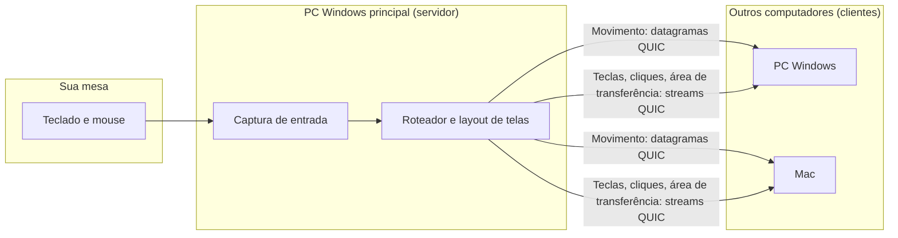

<p align="center">
  
</p>

<h1 align="center">MouseX</h1>

<p align="center">
  <b>Um teclado, um mouse e uma área de transferência para todos os seus computadores Windows e Mac.</b><br>
  Instale uma vez. Depois você nem lembra que ele existe.
</p>

<p align="center">
  <a href="README.md">🇺🇸 English</a>
</p>

<p align="center">
  <a href="https://github.com/actus7/mousex/actions/workflows/ci.yml"></a>
  <a href="https://github.com/actus7/mousex/releases/latest"></a>
  
  
</p>

---

## Por que MouseX

Você tem uma mesa com um teclado e um mouse e dois ou três computadores. Trocar de máquina não deveria exigir outro teclado, digitar endereços IP ou editar arquivos de configuração.

O MouseX trata seus computadores como uma mesa larga só. Leve o cursor além da borda de uma tela e ele aparece na próxima máquina. Copie em um computador e cole em outro. A instalação é um único comando em cada computador, e ela continua funcionando depois de reinicializações, suspensão, mudanças de rede e de monitor.

## Destaques

- 🖱️ **O cursor atravessa as bordas das telas** entre Windows e Mac, monitor por monitor.
- 🧭 **Arrumar telas…** abre um editor visual. Arraste as telas para combinar com a sua mesa de verdade.
- 📋 **Área de transferência sincronizada** para texto, imagens e **arquivos e pastas**. Copie no Explorador e cole no Finder, e vice-versa. Arquivos de até 2 GB.
- 🔐 **Pareado e criptografado.** Cada dispositivo tem a sua própria chave. O pareamento mostra o mesmo código de 6 dígitos nas duas máquinas, e você confirma nas duas.
- 🔎 **Sem endereços IP.** Os computadores se encontram na rede local.
- 🔁 **Reconecta sozinho** depois de suspensão, reinicializações e mudanças de rede.
- ⌨️ **Controles pelo teclado** para pular de uma máquina para outra (veja [Atalhos](#atalhos)).
- 🎵 **Teclas de mídia** (play/pause, próxima, anterior, volume, mudo) funcionam também no Mac.
- 🇧🇷 **Teclados ABNT2 e internacionais** funcionam por código de varredura.
- 🪶 **Leve.** Escrito em Rust. Nada roda em segundo plano além do agente e de um ícone na bandeja. O editor só roda enquanto está aberto.
- 🕵️ **Sem nuvem, sem conta, sem telemetria.**

## Início rápido

### Windows

Abra o PowerShell e execute:

```powershell
irm https://github.com/actus7/mousex/releases/latest/download/install.ps1 | iex
```

1. Aprove o pedido de administrador (UAC).
2. Responda **"Este é o computador cujo teclado e mouse você usa?"**. Sim define este PC como o computador principal. Não define como computador controlado.
3. Repita em cada outro PC Windows. O primeiro pareamento mostra um código de 6 dígitos. Confirme nas duas telas.

Prefere não usar comando? Baixe `MouseX-windows-x64.zip` na [página de versões](https://github.com/actus7/mousex/releases/latest), extraia o arquivo e clique duas vezes em `mousex.exe`. Você verá as mesmas perguntas.

### macOS

Abra o Terminal e execute:

```bash
curl -fsSL https://github.com/actus7/mousex/releases/latest/download/install.sh | bash
```

1. Conceda **Acessibilidade** ao `mousex-agent` em **Ajustes do Sistema → Privacidade e Segurança → Acessibilidade**. O MouseX precisa disso para receber e enviar entradas.
2. Confirme o código de pareamento no Mac e no computador principal.
3. Pronto. O MouseX inicia a cada login.

> **Instale primeiro o PC Windows principal**, depois os outros. Cada máquina nova pede o pareamento uma vez. Depois disso, ela fica lembrada.

### Atualizar e desinstalar

- **Atualizar:** execute o mesmo comando de instalação de novo. Os pareamentos e o layout de telas são mantidos.
- **Desinstalar no Windows:** **Configurações → Aplicativos → MouseX**, ou execute `"C:\Program Files\MouseX\mousex.exe" uninstall` em um terminal elevado.
- **Desinstalar no macOS:** `~/Library/Application\ Support/mousex/bin/mousex uninstall`

### Requisitos

| | |
|---|---|
| **Windows** | Windows 10 ou 11, x64 |
| **macOS** | macOS 12 ou mais recente, Apple Silicon ou Intel |
| **Rede** | Todos os computadores na mesma rede local, sem isolamento de clientes no Wi-Fi |
| **Firewall** | Portas UDP **41414** (conexão) e **41415** (descoberta) |

## Capturas de tela

<p align="center">
  
  <br><sub>Arrumar telas: arraste os monitores para combinar com a sua mesa.</sub>
</p>

O menu da bandeja numera os computadores da esquerda para a direita, igual aos atalhos:

```text
●  Laptop       Ctrl+Alt+Shift+1
●  MacBook      Ctrl+Alt+Shift+2
●  Desktop      Ctrl+Alt+Shift+3
──────────────────────────────
   Pausar compartilhamento
✓  Prender cursor na tela   Scroll Lock
   Reconectar máquinas
──────────────────────────────
   Arrumar telas…
   Abrir log
```

## Atalhos

| Teclas | Ação |
|---|---|
| <kbd>Ctrl</kbd> + <kbd>Alt</kbd> + <kbd>Shift</kbd> + <kbd>1</kbd> … <kbd>9</kbd> | Vai para a máquina *N*, contando da esquerda para a direita na sua mesa |
| <kbd>Scroll Lock</kbd> | Prende o cursor na máquina atual. Ele ainda pode se mover entre os monitores dessa máquina |
| <kbd>Ctrl</kbd> + <kbd>Alt</kbd> + <kbd>Shift</kbd> + <kbd>Home</kbd> | Emergência: traz o cursor de volta para casa |

O menu da bandeja oferece as mesmas ações: **Pausar compartilhamento**, **Prender cursor na tela**, **Reconectar**, **Arrumar telas…** e **Abrir log**.

## Como funciona

O PC Windows principal, que tem o teclado e o mouse físicos, é o **servidor**. Os outros PCs Windows e os Macs são **clientes**. Por enquanto, um Mac só pode ser cliente.



- **Transporte:** QUIC com TLS 1.3. Cada dispositivo tem o seu próprio par de chaves, e cada dispositivo pareado é lembrado pela impressão digital do certificado.
- **O movimento do mouse** viaja em datagramas não confiáveis, com números de sequência. Pacotes atrasados são descartados, então o cursor nunca sai do lugar.
- **Teclas e cliques** viajam em um stream confiável, na ordem certa.
- **Área de transferência e arquivos** viajam em streams próprios, de baixa prioridade, então uma cópia grande nunca atrasa a digitação.
- **Descoberta:** o MouseX procura o servidor por mDNS (`_mousex._udp`) e por broadcast UDP, e guarda o último endereço que funcionou como plano B.
- **Keepalive** a cada 500 ms. Se um link fica em silêncio, o MouseX solta todas as teclas e botões que estava segurando, para nada ficar preso.

Para o quadro completo, leia [docs/ARCHITECTURE.md](docs/ARCHITECTURE.md).

## Comparação com outras soluções

O MouseX faz uma coisa só: uma mesa pessoal com algumas máquinas Windows e Mac, configurada uma vez.

| | MouseX | Synergy / Deskflow | Barrier / Input Leap | Microsoft Mouse Without Borders | Lan Mouse |
|---|:---:|:---:|:---:|:---:|:---:|
| Código aberto | ✅ | Deskflow ✅ · Synergy ❌ | ✅ | ❌ | ✅ |
| Windows | ✅ | ✅ | ✅ | ✅ | ✅ |
| macOS | ✅ (só cliente) | ✅ | ✅ | – | ✅ |
| Linux | ❌ ainda não | ✅ | ✅ | ❌ | ✅ |
| Mac como máquina principal | ❌ ainda não | ✅ | ✅ | – | – |
| Configuração sem digitar IP | ✅ | – | – | – | – |
| Arquivos e pastas na área de transferência | ✅ | – | – | – | – |
| Continua funcionando após suspensão, rede e mudanças de monitor | ✅ | – | – | – | – |
| Arrastar e soltar arquivos entre máquinas | ❌ ainda não | – | – | – | – |

As células com **–** não são afirmações em nenhum sentido. Consulte a documentação de cada projeto para detalhes.

**Limitações de hoje:** sem Linux, um Mac só pode ser cliente, e não dá para arrastar e soltar arquivos entre máquinas (copiar e colar funciona). Esses itens estão no [roadmap](#roadmap).

## Segurança

- O tráfego é criptografado com TLS 1.3, e cada dispositivo tem a sua própria chave.
- Cada dispositivo novo precisa ser confirmado nas duas máquinas com o mesmo código de 6 dígitos.
- Os dispositivos de confiança ficam em uma lista de permissões. Dispositivos recusados ficam lembrados por um tempo.
- Sem nuvem, sem conta, sem telemetria.

Os detalhes, o modelo de ameaças e como reportar uma vulnerabilidade estão em [SECURITY.md](SECURITY.md).

## Solução de problemas e perguntas frequentes

**O outro computador não aparece.**
- Confirme que os dois estão na mesma rede local.
- No Wi-Fi, desative o isolamento de clientes (às vezes chamado de "AP isolation" ou "isolamento da rede de visitantes") no roteador.
- Confirme que as portas UDP 41414 e 41415 estão liberadas. O instalador as abre apenas para a sub-rede local.
- Abra **Abrir log** no menu da bandeja, ou execute `mousex status`.

**O firewall do Windows está bloqueando o MouseX.**
Execute o instalador de novo em um PowerShell elevado. Ele recria a regra de firewall chamada `MouseX`.

**O cursor não se move no Mac.**
Conceda **Acessibilidade** ao `mousex-agent` em **Ajustes do Sistema → Privacidade e Segurança → Acessibilidade**. Depois, confira se o MouseX está rodando com `~/Library/Application\ Support/mousex/bin/mousex status`.

**Meu Mac é gerenciado pela empresa (MDM).**
Algumas empresas bloqueiam permissões de Acessibilidade ou LaunchAgents. Se o MouseX não iniciar no Mac, peça ao time de TI para permitir o `mousex-agent` em Acessibilidade e o LaunchAgent de usuário `com.mousex.agent`.

**As teclas saem trocadas no Mac.**
Teclados ABNT2 funcionam melhor com o Mac configurado para o layout **Português – ABNT2**. O MouseX mostra uma dica, uma única vez, se o Mac usar outro layout. Ctrl do Windows vira Cmd no Mac, então atalhos como Ctrl+C funcionam como Cmd+C.

**Mudei os monitores e o layout ficou errado.**
O MouseX detecta mudanças de monitor em tempo real. Abra **Arrumar telas…** no menu da bandeja para ajustar o layout. As telas do computador principal sempre seguem a disposição real do Windows.

**Onde ficam os logs?**
- Windows: `C:\ProgramData\MouseX\mousex.log`
- macOS: `~/Library/Application Support/mousex/mousex.log`

**Funciona pela internet?**
Não. O MouseX foi feito para a rede local. Ele não usa servidor de repasse.

## Compilar a partir do código

Veja [CONTRIBUTING.md](CONTRIBUTING.md) para a toolchain, os comandos e a organização do repositório.

## Desinstalar

- **Windows:** **Configurações → Aplicativos → MouseX**, ou `"C:\Program Files\MouseX\mousex.exe" uninstall`
- **macOS:** `~/Library/Application\ Support/mousex/bin/mousex uninstall`

## Roadmap

- Suporte a Linux
- Mac como computador principal (servidor)
- Arrastar e soltar arquivos entre máquinas
- Melhor suporte a layouts de teclado no Mac

Ideias e votos são bem-vindos nas [Issues](https://github.com/actus7/mousex/issues).

## Contribuir

Contribuições são bem-vindas, em inglês ou português. Leia antes o [CONTRIBUTING.md](CONTRIBUTING.md). Por favor, siga o nosso [Código de Conduta](CODE_OF_CONDUCT.md).

As mudanças são listadas no [CHANGELOG](CHANGELOG.md).

## Licença

O MouseX é distribuído sob a licença dupla, à sua escolha:

- [Licença MIT](LICENSE-MIT)
- [Licença Apache, versão 2.0](LICENSE-APACHE)

Salvo declaração explícita em contrário, qualquer contribuição enviada por você fica sujeita aos mesmos termos, sem condições adicionais.
