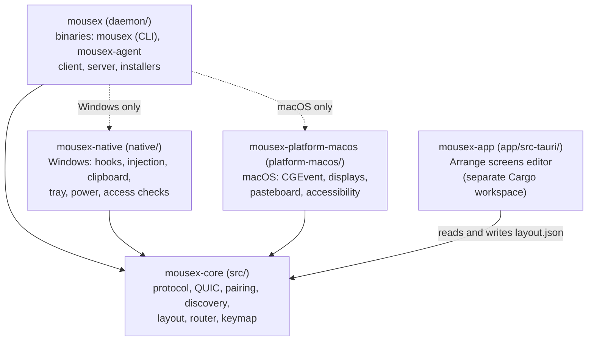
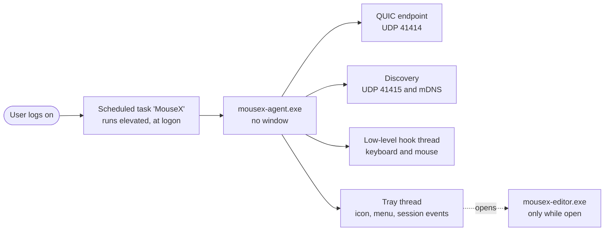
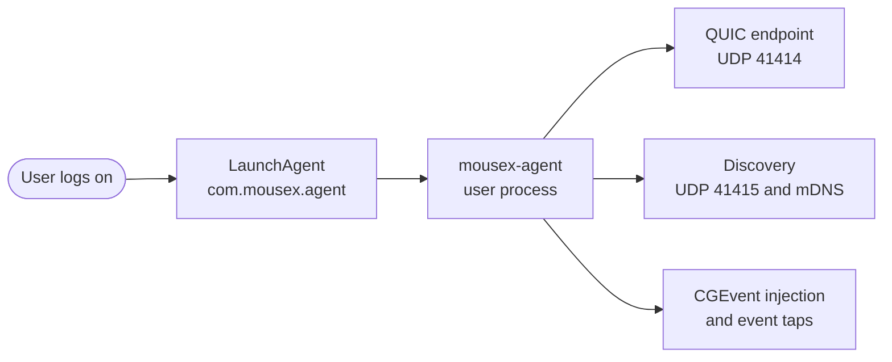
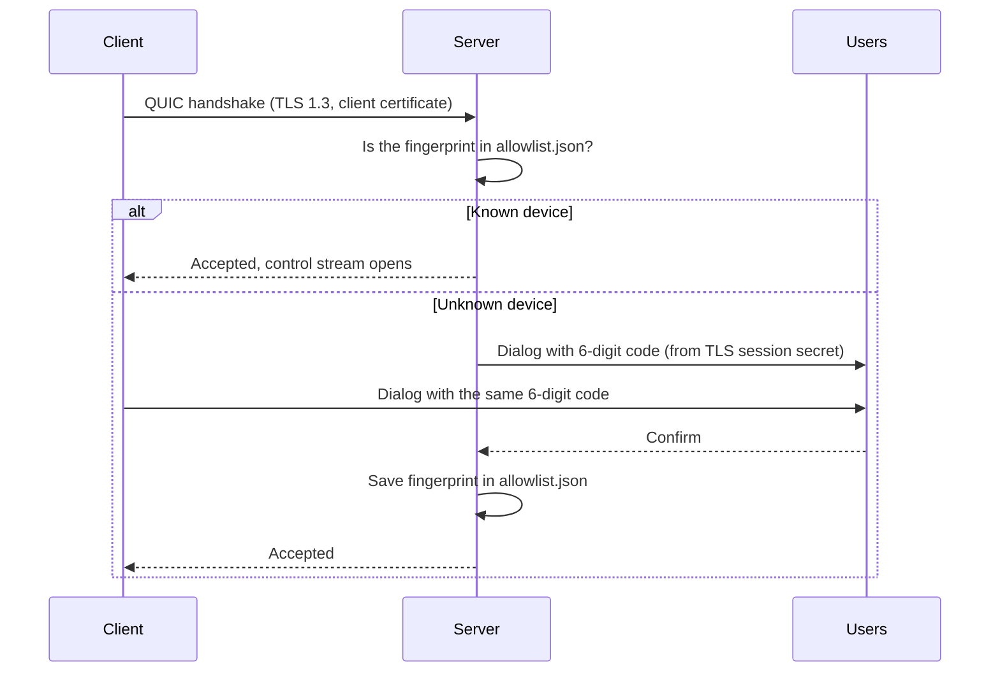

# MouseX architecture

This document describes how MouseX is built: the crates, the processes, the wire protocol, how the screen layout drives the cursor, how computers find each other, and where data lives. Read it before a larger change.

## Crates



| Crate | Path | Responsibility |
|---|---|---|
| `mousex-core` | `src/` | Platform-independent logic: the wire protocol (`proto.rs`), QUIC endpoints and certificate handling (`net.rs`), device identity (`identity.rs`), pairing codes and the allowlist (`pairing.rs`), discovery (`discovery.rs`), screen layout and edge routing (`router.rs`), and key maps between Windows, HID, and macOS (`keymap.rs`). |
| `mousex-native` | `native/` | Windows backend. Low-level keyboard and mouse hooks that never block, input injection, clipboard (text, DIB and PNG images, file lists), the tray icon and menu, power and session events, access checks, and helpers for the installer. |
| `mousex-platform-macos` | `platform-macos/` | macOS backend. Event injection with CoreGraphics, display detection, pasteboard access (text, PNG, TIFF), accessibility checks, and the keyboard-layout check. |
| `mousex` | `daemon/` | The product itself. The `mousex` CLI, the `mousex-agent` background process, the client and server state machines, clipboard and file transfer (`clip.rs`), the Windows installer (`install.rs`), and the macOS installer (`mac_install.rs`). |
| `mousex-app` | `app/src-tauri/` | The **Arrange screens** editor: a Tauri window with a React front end (`app/src/`). It only runs while open. It is a separate Cargo workspace. |

Platform-specific code is isolated behind traits. The daemon has a `Platform` trait for the client side (keys, buttons, motion, clipboard, lock, keep-awake, monitors), and the server has its own event loop that consumes hook events.

## Processes

### Windows



- **Scheduled task `MouseX`.** Created by the installer. It runs `mousex-agent.exe` at every logon with elevated rights. Those rights let the agent inject input into elevated windows and write to `ProgramData`.
- **Hook thread.** Captures keyboard and mouse events. It forwards them through a channel and returns at once, so input is never delayed.
- **Tray thread.** Shows the machine list with connection status, the menu, and the grey icon when nothing is connected. It also listens for session lock events (Win+L).
- **Editor.** Started from the tray menu. It is not a background service.

The `mousex.exe` CLI is the same program. It runs `install`, `uninstall`, and `status`, and it has a dialog for choosing the role.

### macOS



- **LaunchAgent `com.mousex.agent`** is installed in `~/Library/LaunchAgents`. It needs no administrator rights.
- **Accessibility.** The user grants Accessibility to `mousex-agent`. Without it, the agent can run but cannot inject or capture input.
- **Signing.** The installer signs the binaries with a local self-signed identity, so macOS keeps the Accessibility permission across updates.
- The macOS build is **client only**. It can receive the cursor, keys, clipboard and files, and it can lock its own screen.

## Roles and state machines

- **Server** (Windows only): owns the physical keyboard and mouse. It accepts paired clients, tracks which machine the cursor is on, and sends `Enter`, `Leave`, keys, clicks, wheel events, and clipboard requests.
- **Client** (Windows or macOS): connects to the server, announces its name and monitors with `Hello`, and applies what the server sends. It reconnects with backoff starting at 250 ms and capped at 2 s. A connection that stayed up for at least 5 s resets the backoff. When the link drops, it releases every held key and button.

## Wire protocol

Three channels carry traffic over one QUIC connection.

| Channel | QUIC mechanism | Used for | Delivery |
|---|---|---|---|
| Control | One bidirectional stream, preceded by a single byte `0x53` | `Hello`, `Enter`, `Leave`, keys, clicks, wheel, clipboard pull, activity, lock | Reliable, in order |
| Motion | Unreliable datagrams | Absolute cursor position on a monitor | Unreliable; latest wins |
| Clipboard and files | One unidirectional stream per transfer, low priority (`-1`) for files | Text, PNG images, file lists | Reliable, one transfer per stream |

Other QUIC settings: ALPN `mousex/1`, keepalive every 500 ms, and idle timeout of 1.5 s. A connection that stops answering is dropped, and the client starts reconnecting.

### Control frames

Each control message is a frame:

```text
+----------------------+------------------------------+
| length: u32 (LE)     | body: JSON (serde, tagged)   |
+----------------------+------------------------------+
```

- The length must be greater than zero and at most **64 KiB** (`MAX_CONTROL_BYTES`).
- A message this version does not know, sent by a newer peer during an upgrade, is consumed and skipped. The reader moves on to the next frame. This keeps a mixed-version pair working during an update.

Control messages:

| Message | Direction | Meaning |
|---|---|---|
| `Hello { machine, monitors }` | client → server | On connect, and whenever the monitors change |
| `Enter { monitor_id, x, y }` | server → client | The cursor entered this client, at local coordinates |
| `Leave` | server → client | Release everything |
| `Key { hid, down }` | server → client | Keyboard key, as a USB HID usage |
| `Button { button, down, monitor_id, x, y }` | server → client | Mouse button, with the cursor position |
| `Wheel { dx, dy }` | server → client | Scroll |
| `ClipboardPull` | server → client | The cursor left; send the clipboard if it changed |
| `Activity` | server → client | A user is active somewhere; do not lock for idleness |
| `Lock` | server → client | The main PC was locked with Win+L; lock this screen too |

### Motion datagram

Motion uses a fixed 15-byte packet, all integers little-endian:

| Offset | Size | Field |
|---|---|---|
| 0 | 1 | Tag, always `0x4D` (`M`) |
| 1 | 4 | `seq`: `u32` sequence number |
| 5 | 2 | `monitor`: `u16`, index into the client's `Hello.monitors` |
| 7 | 4 | `x`: `i32`, local pixels |
| 11 | 4 | `y`: `i32`, local pixels |

A receiver ignores a packet that is not newer than the last one it applied. Comparison wraps around, so the sequence number can roll over. Lost packets are simply skipped, and the cursor never drifts.

### Clipboard and file streams

```text
+--------------+----------------------+------------------------------+
| kind: u8     | length: u32 (LE)     | payload                      |
+--------------+----------------------+------------------------------+
```

| Kind | Name | Payload | Limit |
|---|---|---|---|
| `1` | Text | UTF-8 text | 10 MiB |
| `2` | PNG | PNG image | 32 MiB |
| `3` | Files | JSON manifest, then the bytes of each file in manifest order | Manifest 4 MiB; 2 GiB total; 10,000 entries |

A file transfer sends the manifest (paths and sizes) first, then the contents. If a file shrinks during the copy, the sender aborts, and the receiver discards the partial copy. Transfers have a timeout that grows with the size of the copy.

## Screen layout and routing

### Layout

The layout is a list of monitors in **global desk coordinates**:

```json
{"monitores":[
  {"id":"casa:1","machine":"Este computador","x":0,"y":0,"width":3440,"height":1440,"scale_fator":1.0},
  {"id":"mac:1","machine":"mac","x":-1470,"y":242,"width":1470,"height":956,"scale_fator":1.0}
]}
```

- `x`, `y`, `width`, and `height` are integer global pixels. Bounds are half-open.
- `scale_fator` converts global pixels to a machine's logical coordinates: `local = (global - origin) / scale`.
- Monitor IDs must be unique and not empty. The `machine` name must not be empty. An empty layout is valid.
- **Home screens** (the screens of the computer with the physical keyboard) are locked to the real Windows arrangement, so the editor cannot make them lie about where they are.
- Other machines' screens can be placed anywhere. The **size on desk** slider changes the area a screen occupies without changing its resolution.

### Router

The router turns cursor movement into machine changes:

1. **Home movement** comes from the hook. The router clamps the cursor to the desk bounds and checks whether it crossed the edge of a monitor.
2. **Edge detection** looks for a neighbor monitor on the other side of the edge. A transition only happens when the monitors are physically adjacent. There is no wrap-around.
3. **Remote movement** comes from relative deltas. The router moves a virtual point on the desk, clamps it to the current monitor, and when it leaves the monitor through an edge, it finds the monitor on that side.
4. The router sends `Enter` to the new machine (or `Leave` back to home), at the matching local position.
5. **Jumps** (`Ctrl+Alt+Shift+N`, or the tray) move the cursor to the first monitor of machine *N*, counting left to right. **Force home** (the emergency hotkey) brings the cursor back to the home screen.
6. **Scroll Lock** toggles a lock that keeps the cursor on the current machine.

Movement is handled in two modes. While the cursor is at home, the hook's absolute positions are used. While it is remote, only relative deltas are used, and deltas that look implausible (too large in one event) are dropped.

## Discovery

The client wants a specific server fingerprint, or any server before pairing (`*`).

1. A **UDP broadcast** on port `41415` sends `MOUSEX?` (padded to at least 128 bytes). A server answers `MOUSEX!` with its fingerprint and QUIC port.
2. In parallel, an **mDNS** browse looks for `_mousex._udp.local.`.
3. The first match within the timeout (2 s) wins. A match for a known fingerprint is saved in `last_server.json`.
4. If nothing answers, the client uses the cached address for that fingerprint.

There is no IP address to configure.

## Pairing



- The **code** is an HMAC-SHA256 of the peer fingerprint, keyed with the TLS exporter secret (label `mousex pairing v1`), taken modulo 1,000,000. Both sides compute it from the same session, so they show the same code. A different TLS session gives a different code.
- The handshake accepts any certificate and checks its signature. Authorization is separate and happens after the handshake, through the allowlist and the human confirmation.
- A rejected device is remembered for 10 minutes. Only one pairing dialog is open at a time.
- The client remembers the server's fingerprint in `config.json` and reconnects only to it.

## Data locations

| Item | Windows (installed) | macOS |
|---|---|---|
| Data folder | `C:\ProgramData\MouseX` | `~/Library/Application Support/mousex` |
| Who can write | Administrators only | The user |
| Identity (certificate and key) | `identity.der`, `identity.pk8` | same |
| Paired devices | `allowlist.json` | same |
| Screen layout | `layout.json` | same |
| Last server address | `last_server.json` | same |
| Settings (role, machine name, pinned server) | `config.json` | same |
| Log | `mousex.log`; when it passes about 1 MB, it is renamed to `mousex.log.old` and a new one starts | same |
| Installed binaries | `C:\Program Files\MouseX` | `~/Library/Application Support/mousex/bin` |
| Received files and folders | `recebidos` inside the data folder, one new subfolder per transfer; the two most recent are kept | same |

Before an install, a Windows user's data folder is `%APPDATA%\mousex`. The installer moves `identity.der`, `identity.pk8`, `allowlist.json`, `layout.json` and `last_server.json` to `ProgramData` and keeps the pairings. Data from older builds that used the name Sculpin is migrated the same way, but only from a folder that is protected like the new one.

The log file is `mousex.log`. Use the tray's **Open log** item, or `mousex status`, to see it.

## Installers

| Step | Windows | macOS |
|---|---|---|
| Admin rights | Yes (UAC) | No |
| Binaries | Copied to `C:\Program Files\MouseX` | Copied to `~/Library/Application Support/mousex/bin` |
| Autostart | Scheduled task `MouseX`, at logon, elevated | LaunchAgent `com.mousex.agent` |
| Firewall | Rule `MouseX`, UDP 41414 and 41415, remote `localsubnet` | Not applicable |
| Permission | None extra | Accessibility for `mousex-agent` |
| Update | Run the installer again | Run the installer again |
| Uninstall | Settings → Apps, or `mousex uninstall` | `mousex uninstall` |

Updates keep pairings, the layout, and the identity, so already-paired machines reconnect without a new code.

## Design decisions

- **QUIC with TLS 1.3** gives encryption, multiplexing, and datagrams in one protocol, without managing separate sockets.
- **Datagrams for motion** keep the cursor responsive. A late packet is worth nothing, so it is dropped instead of retransmitted.
- **JSON for control, binary for motion.** Control messages are infrequent, so readability wins. Motion is the hot path, so it has a fixed binary layout.
- **Hooks never block.** The OS disables a slow low-level hook, so all work is handed to other threads.
- **Allowlist as the only durable grant.** Nothing is trusted because it is on the local network. Trust is a file the user can read.
- **No central server.** Discovery is local, so the desk works without any service.
